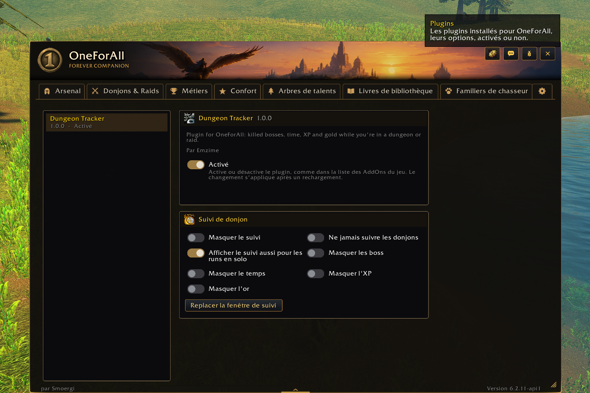
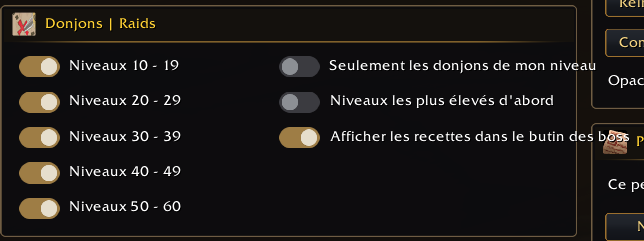
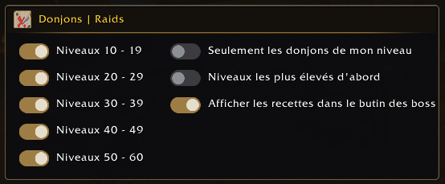

# OneForAll – Plugin API

An **unofficial** build of [OneForAll](https://discord.gg/JSPUqw4g), the all-in-one WoW Forever companion by **Smoergi**, with a **plugin API** (`OneForAllAPI`) and a **Plugins** page.

Plugins are separate addons. They can read everything OneForAll knows and add their own options and commands, without ever being able to change OneForAll. OneForAll and its plugins can each be updated on their own, and OneForAll works exactly the same without any plugin.

> This repository is a proposal to OneForAll's author. OneForAll belongs to Smoergi: for the official version, updates, support, bug reports and suggestions, join the **[OneForAll Discord](https://discord.gg/JSPUqw4g)**.

| Folder | What it is | Version |
|---|---|---|
| `OneForAll/` | OneForAll **6.2.12** + the plugin API | `6.2.12-api1` |

The `-api1` suffix marks a test build for OneForAll's version check: it never tells other players about a "newer version", and you are still told when the official 6.2.13 / 6.3.0 comes out. Screenshots were taken in game with a French client.

## Documentation

| Page | For |
|---|---|
| [User guide](docs/user-guide.md) | Players: installing plugins, the Plugins page, turning plugins on or off, troubleshooting. |
| [Plugin guide](docs/plugin-guide.md) | Plugin authors: a step-by-step guide, from an empty folder to a published plugin. |
| [API reference](docs/api-reference.md) | Plugin authors: every function, with its arguments, what it returns and since which version. |
| [`examples/MyFirstPlugin`](examples/MyFirstPlugin) | A small, complete plugin to copy and start from. |

## Plugins

| Plugin | What it does |
|---|---|
| [Dungeon Tracker](https://github.com/Emzime/Plugin-DungeonTracker-OneForAll) | Killed bosses, time, XP and gold while you're in a dungeon or raid. |

---

## What changes in OneForAll

Very little, so it's easy to take over in each new version:

| File | Change |
|---|---|
| `API.lua` | **New.** The whole API (the global `OneForAllAPI`, thin wrappers over OneForAll's own functions) and the Plugins page. |
| `UI/MainFrame.lua` | A page can have a button in the title bar instead of a tab (`noTab`): the tab bar is already full in French or German. The Plugins page uses it. |
| `OneForAll.toc` | Loads `API.lua` last. Version `6.2.12-api1`. |
| `Core.lua` | `/ofa <word>` hands a plugin its command (5 lines before the `else` that opens the window). |
| `UI/Settings.lua` | Not for the API: the fix for long labels (see below). |
| `Locales/{deDE,frFR,esES,ptBR}.lua` | The texts of the Plugins page (11). |

Everything else is OneForAll 6.2.12 as released.

## The Plugins page

As soon as a plugin is installed, a **Plugins** button (gears) appears in OneForAll's title bar, left of the Discord button. It opens the Plugins page, so plugin options never crowd OneForAll's Settings page, however many plugins there are. It is a button rather than a tab because the tab bar is already full in French or German.

- **Left:** every installed plugin, one under the other (the mouse wheel scrolls them when they don't fit, no visible bar), i.e. every addon with `## Dependencies: OneForAll`, even a turned-off one, with its version and whether it is on.
- **Right:** the chosen plugin's page:
  - its description and author (from its `.toc`);
  - an **Enabled** switch that turns it on or off, as in the game's AddOns list, with a **Reload** button to apply it;
  - its settings sections (`API.AddSettingsSection`) and its own blocks (`API.AddPluginContent`).

  This side scrolls with the mouse wheel too, without a visible bar.

<p align="center"></p>
<p align="center"><sub>The Plugins page (gears button, top right) with the <a href="https://github.com/Emzime/Plugin-DungeonTracker-OneForAll">Dungeon Tracker</a> plugin chosen (French client).</sub></p>

## Plugins read everything, change nothing

A plugin is a separate addon. Its `.toc` says `## Dependencies: OneForAll`, so it loads after OneForAll, and it reaches OneForAll **only** through `OneForAllAPI`.

- **Everything readable.** `API.Data` holds all of OneForAll's data, read only: dungeons, quests, items, sets, professions, recipes, books, pets, talents, maps, flight paths…
- **Nothing writable.** Every table the API hands out is read only, and writing into one raises an error. A plugin can't change OneForAll's data, saved data, options or functions, nor replace a function of `OneForAllAPI`. Only OneForAll's existing functions, exposed by name, can be called; data tables never carry functions out.
- **Its own space.** A plugin writes only its own options (`API.NewOptions`), stored in OneForAll's profile under `plugin.<name>.<key>`, a name OneForAll never uses. It gets its part of the Plugins page and can add `/ofa` commands and callbacks, but never replace or remove OneForAll's or another plugin's.
- **Stable.** `API.VERSION` goes up when something is added; what exists stays as it is, so plugins keep working.

> In WoW, all addons share one Lua space, so nothing can stop an addon that edits OneForAll's saved variables or frames by itself. What the API guarantees is that it never hands out a way to change OneForAll.

Read-only tables look like normal tables (`d.name`, `d.bosses[1]`), but Lua 5.1's own `pairs`, `ipairs` and `#` can't see through them. Use `API.pairs`, `API.ipairs` and `API.Count`, or `API.Copy` for a plain copy of your own.

```lua
-- MyPlugin.lua (MyPlugin.toc: "## Dependencies: OneForAll")
local API = OneForAllAPI
if not (API and API.VERSION >= 2) then return end

API.RegisterPlugin("MyPlugin", { title = "My Plugin", version = "1.0.0" })
local opts = API.NewOptions("MyPlugin", { enabled = true })   -- in OneForAll's profile

API.AddSettingsSection("MyPlugin", { title = "My Plugin", build = function(s)  -- on the Plugins page
  s:check("Enable", "What it does.", function() return opts:Get("enabled") end,
    function(v) opts:Set("enabled", v) end)
end })

API.RegisterSlashCommand("bosses", function(rest)            -- /ofa bosses ragefire chasm
  for _, d in API.ipairs(API.Data.DUNGEONS) do
    if d.name:lower() == rest then
      API.Print(API.DungeonName(d.name) .. ": " .. API.Count(d.bosses) .. " bosses")
    end
  end
end)

API.RegisterCallback("TAB_SHOWN", function(key) API.Print("Page: " .. key) end)
```

## Reference (`OneForAllAPI`, version 3)

| Area | Functions |
|---|---|
| **Read-only data** | `Data` (every data table: `Data.DUNGEONS`, `Data.SETS`, `Data.BOOKS`, `Data.PROFESSION_RECIPES`…), `DataKeys()`, `pairs(t)`, `ipairs(t)`, `Count(t)`, `Copy(t)`, `IsReadOnly(t)` |
| **About OneForAll** | `VERSION`, `GetVersion()`, `GetLanguage()`, `Translate(text)`, `Name(englishName)`, `Print(text)`, `IsSecret(...)`, `SafeCall(tag, fn, ...)` |
| **Plugins** | `RegisterPlugin(name, info)`, `GetPlugins()`, `GetInstalledPlugins()` (`/ofa plugins` lists them) |
| **Window** | `OpenTab(key)`, `ToggleWindow()`, `IsWindowShown()`, `GetActiveTab()`, `GetTabs()` |
| **Dungeons** | `GetDungeons()`, `GetDungeon(name)`, `GetDungeonsByInstanceID(id)`, `FindCurrentDungeon()`, `DungeonName(name)`, `IsSummonedBoss(npcID)`, `OpenDungeon(d, bossName, mode, questID)`, `IsRaidOpen(d)` |
| **Quests** | `IsQuestDone(id)`, `IsQuestGrey(id, level)`, `GetQuestInfo(id)`, `IsQuestForMe(id)`, `GetQuestStart(id)`, `GetQuestEnd(id)`, `ShowQuestStartOnMap(quest)` |
| **Library books** | `FindBookByQuestID(id)`, `GetBookState(book)`, `GetBookCounts()`, `ShowBook(book)`, `ShowBookOnMap(book)` |
| **Items, recipes, map** | `GetItemStorageState(itemID)`, `GetRecipeFullName(recipe)`, `GetRecipeItemLink(recipe)`, `FindMapID(zone)` |
| **Saved data (read only)** | `GetCharacterKey()`, `GetCharacterData()`, `GetAccountData()` |
| **Options** | OneForAll's (read only): `GetOption(key)`, `OnOptionChanged(key, fn)`. The plugin's own: `NewOptions(name, defaults)` → `:Get(key)`, `:Set(key, value)`, `:OnChanged(key, fn)` |
| **Plugins page** | `AddSettingsSection(name, { title, icon, build })`: a section of settings in the plugin's part of the page; `build(s)` uses `s:check`, `s:button`, `s:text`, `s:nextRow`, and `s.width` (the sections take the page's whole width). `AddPluginContent(name, { title, icon, height, build })`: a free block for anything else (a list, a summary…), `build(frame, width)` |
| **Slash commands** | `RegisterSlashCommand(word, fn, help)`: `/ofa <word> [rest]` |
| **Callbacks** | `RegisterCallback(event, fn)`, `UnregisterCallback(event, fn)`. Events: `OPTION_CHANGED`, `TAB_SHOWN`, `WINDOW_SHOWN`, `WINDOW_HIDDEN`, `DATA_REFRESHED` |
| **Widgets** | `Widgets.FramedPanel`, `CloseButton`, `GoldButton`, `Confirm`, `FontString`, `SetTexture`, `SkinColor` |

Every function is described in the [API reference](docs/api-reference.md) and in the comments of [`OneForAll/API.lua`](OneForAll/API.lua). Something a plugin needs and can't do yet becomes a new function in a later version (`VERSION` 4…), never a change to an existing one.

---

## Settings: long labels no longer overflow

In languages with long labels (French, German…), the switches in the *Dungeons | Raids* box ran past the edge of the box. Labels now wrap onto a second line if needed, and that box's right column sits a little further left. The Plugins page uses the same switches.

<table align="center"><tr>
<td align="center"><br><sub>Before</sub></td>
<td align="center"><br><sub>After</sub></td>
</tr></table>

---

## Install

1. Download `OneForAll-<version>.zip` from the latest **Release** (or from the **Actions** tab, artifacts of the last build).
2. Close the game. Put its `OneForAll` folder into your WoW Forever client's `Interface/AddOns` folder, replacing the old one.
3. Install the plugins you want next to it (see **Plugins** above). Their options are on OneForAll's **Plugins** page (gears button in the title bar); `/ofa plugins` lists them too.

## Build

`.github/workflows/build.yml` checks every Lua file and builds `OneForAll-<version>.zip`:
- on every push and pull request, as a workflow artifact;
- when a tag starting with `v` is pushed (e.g. `git tag v6.2.12-api1 && git push --tags`), also as a GitHub release.

For a new build, raise the suffix in `OneForAll/OneForAll.toc` (`## Version: 6.2.12-api2`) and tag it the same way (`v6.2.12-api2`). Keep tags in lower case: GitHub sorts releases by comparing tag names.

## Credits & license

- **OneForAll** © Smoergi, licensed under **GPL-3.0-or-later** (see `OneForAll/LICENSE.txt` and `OneForAll/THIRD_PARTY_LICENSES.txt`). This modified version is under the same license. The changes are listed above.
- Official OneForAll, support and suggestions: **https://discord.gg/JSPUqw4g**
