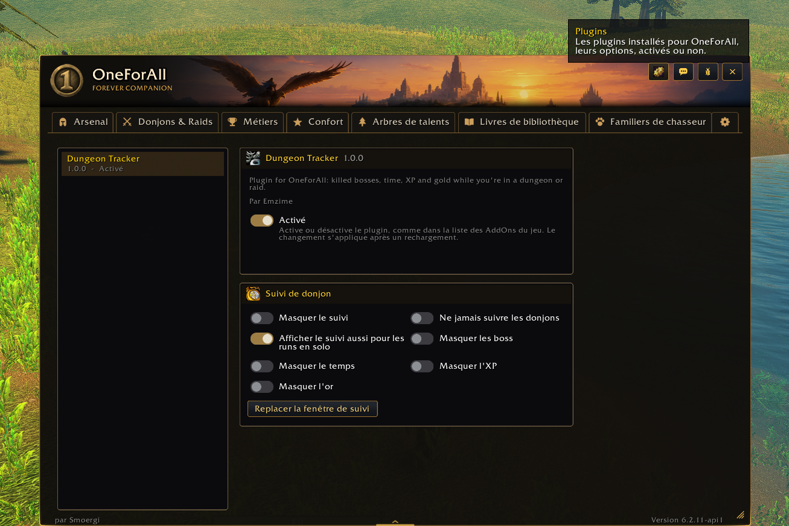

# Using OneForAll with plugins

This page is for players. To write a plugin, see the [plugin guide](plugin-guide.md).

## What a plugin is

A plugin is a separate addon that adds something to OneForAll: a window, options, a command… It has its own folder in `Interface/AddOns` and only runs with OneForAll installed.

- OneForAll works exactly the same without any plugin.
- A plugin can read what OneForAll knows (dungeons, quests, books…) but can't change OneForAll.
- Each plugin is made and updated by its own author, separately from OneForAll.

The same idea is used by many addons: Titan Panel, ElvUI, Details!, Deadly Boss Mods…

## Install

1. **OneForAll with the plugin API.** Download `OneForAll-<version>.zip` from the [releases](https://github.com/Emzime/OneForAll-API/releases). Close the game and put its `OneForAll` folder into `Interface/AddOns`, replacing the old one.
2. **The plugins you want.** Each one comes as its own zip: put its folder into `Interface/AddOns`, next to `OneForAll`. The plugins are listed in the [README](../README.md#plugins).
3. Start the game.

```
Interface/
  AddOns/
    OneForAll/                  <- OneForAll with the plugin API
    OneForAll_DungeonTracker/   <- a plugin
```

## The Plugins page

As soon as a plugin is installed, a **gears button** appears in OneForAll's title bar, left of the Discord button. It opens the **Plugins** page.

<p align="center"></p>

- **Left:** every installed plugin, with its version and whether it is on. Click one to see its page. The mouse wheel scrolls the list when it is long.
- **Right:** the chosen plugin's page:
  - its description and author;
  - the **Enabled** switch;
  - its options, and anything else it shows (a list, a summary…). The mouse wheel scrolls this side too.

There is no gears button when no plugin is installed.

## Turning a plugin on or off

Use the **Enabled** switch on its page, then the **Reload** button next to it: as in the game's AddOns list, the change applies after a reload. The game's AddOns list (character screen) works too.

A plugin that is off stays in the list, so you can turn it back on.

## Options and profiles

A plugin's options are saved in **OneForAll's profile** for the character, next to OneForAll's own options:
- they follow the profile when you change it;
- they are included when you export or import a profile.

## Commands

| Command | What it does |
|---|---|
| `/ofa plugins` | Lists the plugins that are loaded, with their version and command. |
| `/ofa errors` | OneForAll's error list, plugins' errors included. |
| `/ofa plugin_<name>` | A plugin's command, if it has one: e.g. `/ofa plugin_dungeontracker`, or its short form `/ofa plugin_dt`. It is shown on the plugin's page. |

Every `/ofa plugin_…` command belongs to a plugin, and every other `/ofa` command to OneForAll, so they never get in each other's way.

## Updating

OneForAll and the plugins update separately:
- **OneForAll:** replace the `OneForAll` folder with the new one. Your plugins keep working: the API only ever adds functions, it never changes existing ones.
- **A plugin:** replace its folder. OneForAll doesn't need to change.

## Something goes wrong

- **No gears button:** no plugin is loaded. Check that the plugin's folder is directly in `Interface/AddOns` (not in a sub-folder from the zip), and that it is enabled in the AddOns list.
- **A plugin is listed but shows "This plugin is turned off":** turn it on with its switch, then reload.
- **An error from a plugin:** errors in what OneForAll runs for a plugin (its options, commands, callbacks) go to OneForAll's error list instead of a Lua popup: `/ofa errors` shows it, `/ofa errors clear` empties it. Report a plugin's error to the plugin's author, not to OneForAll's.
- **The plugin needs a newer OneForAll:** a plugin that needs a newer API version usually does nothing with an older OneForAll (no options, no command). Update OneForAll.
